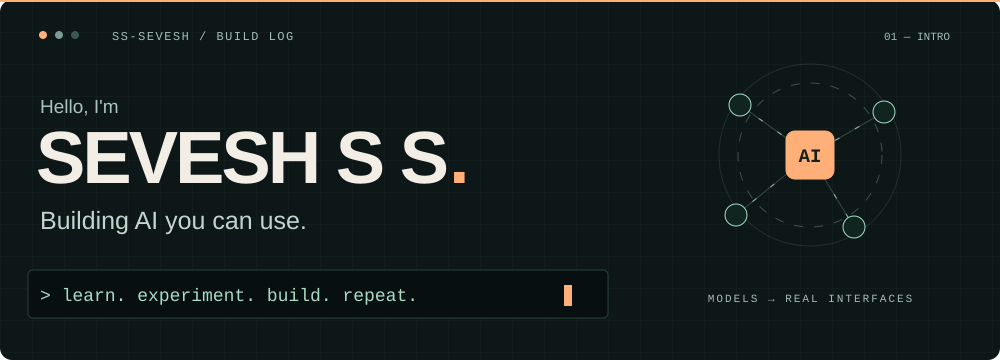
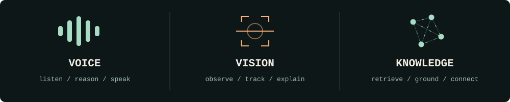
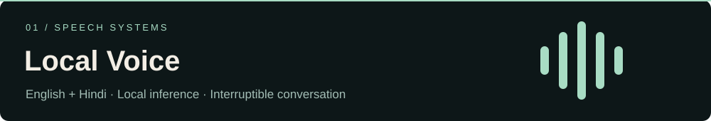
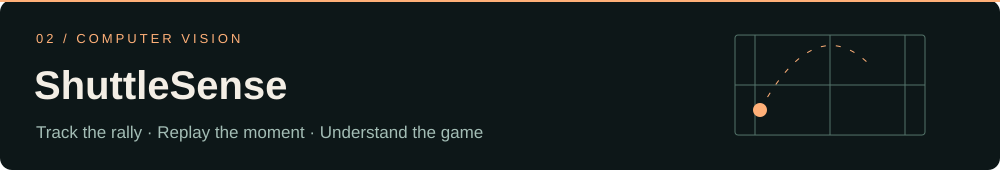
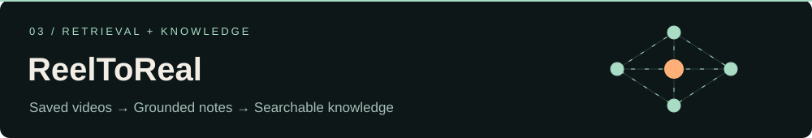
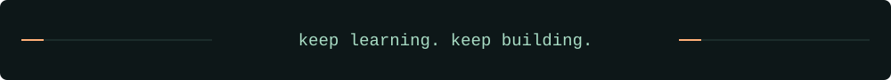

  

  <strong>AI &amp; Machine Learning student @ KEC · Full-stack developer</strong> 
  Exploring local AI, computer vision, and tools that turn information into something useful.

  <a href="#selected-work">Selected work</a> &nbsp; / &nbsp;
  <a href="https://github.com/ss-sevesh/localvoice#watch-the-demo">Watch a demo</a> &nbsp; / &nbsp;
  <a href="https://github.com/ss-sevesh?tab=repositories">All repositories</a>

## From an idea to something you can try.

I like connecting models to real interfaces: a voice you can interrupt, a rally you
can replay, or an answer you can trace back to its source. My projects span speech,
vision, retrieval, and the full-stack applications around them.

  

## Selected work

### 01 / [Local Voice](https://github.com/ss-sevesh/localvoice)

A local voice companion for **English, Hindi, and Hinglish**. Speak naturally,
see the answer stream in, and interrupt the reply with your voice.

`Python` · `FastAPI` · `React` · `Whisper` · `Qwen` · `Kokoro`

[**Watch the audible English + Hindi demo →**](https://github.com/ss-sevesh/localvoice#watch-the-demo)

[Open the silent workspace preview](https://raw.githubusercontent.com/ss-sevesh/localvoice/main/docs/assets/conversation.gif). Both speakers are audible in the full demo above.

### 02 / [ShuttleSense](https://github.com/ss-sevesh/shuttlesense)

Local AI badminton video analysis: **rally replay, shuttle tracking, body poses,
heatmaps, and coaching reports** grounded in the footage.

`Python` · `Computer vision` · `Video analysis`

### 03 / [ReelToReal](https://github.com/ss-sevesh/reeltoreal)

Turn saved short videos into an **Obsidian-compatible local knowledge vault**,
with timestamped notes, speech recognition, visual understanding, and hybrid retrieval.

`TypeScript` · `Whisper` · `Moondream` · `Qdrant` · `RAG`

## Building, one contribution at a time.

The green cells show real contribution levels. The moving line is decorative;
this is a periodically refreshed snapshot, not live telemetry.

Watch the contribution snake

Generated from my GitHub calendar with [Platane/snk](https://github.com/Platane/snk).
Animations stop when your device requests reduced motion.

## Recently on the workbench

[Read the activity log and open its repositories →](https://github.com/ss-sevesh/ss-sevesh/blob/output/activity.md)

Public development events refresh every six hours; GitHub's feed can be delayed.

## More experiments, more angles.

| Project | What it explores |
|---|---|
| [Chemistry Tutor](https://github.com/ss-sevesh/hawc-chemistry-tutor) | PDF retrieval and local answers with source citations |
| [Manufacturing Quality Predictor](https://github.com/ss-sevesh/manufacturing-quality-predictor) | An ML prediction system with a FastAPI backend and React dashboard |
| [AQI Model](https://github.com/ss-sevesh/Aqi-Model) | Satellite-based air-quality prediction and leave-city-out validation |
| [Student Attendance System](https://github.com/ss-sevesh/student-attendance-system) | A campus attendance and registration application |

  

  <a href="https://github.com/ss-sevesh?tab=repositories"><strong>Explore the source ↗</strong></a>

How this profile is animated

GitHub displays this README because its public repository matches my username.
The header, project illustrations, calendar, activity, and footer are SVG images with CSS animations. They
respect reduced-motion preferences and keep their text visible without animation.
The linked product preview is a GIF captured from the real application.

GitHub Actions refreshes the calendar and public activity using GitHub's APIs.
Generated artwork lives on the `output` branch. Failed updates preserve the last
successful snapshot. There are no visitor counters or generated skill scores.
See [the design notes](DESIGN.md) for references and editing instructions.

